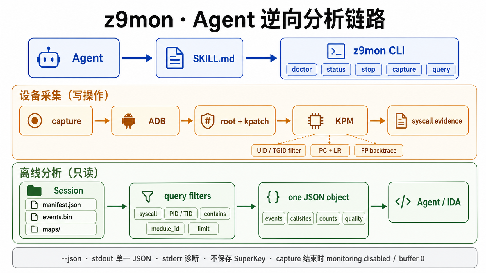

# Z9Null Monitor CLI

面向 Codex、ZCode、Claude Code 等 AI Agent 的 Android syscall 动态分析 CLI。

CLI 通过 ADB、root shell 和 KernelPatch Module（KPM）采集目标进程的
syscall 运行时证据，并以稳定、可查询的 JSON 与二进制产物提供给
Agent。

## 项目定位

Z9Null Monitor 是独立的 syscall 观测工具，Agent 根据分析目标自行决定何时调用本工具。



```text
Codex / Claude Code / Human
              │
           z9mon CLI
              │ ADB + root + kpatch ctl0
              ▼
    Android ARM64 KernelPatch KPM
              │
              ▼
       binary event artifacts
```

## 当前能力

- `doctor`：检查 ADB、设备、ABI、root、kpatch 和 SuperKey 配置。
- `status`：读取 `z9null_monitor` KPM 状态。
- `stop`：幂等地暂停 KPM 监控。
- `capture`：按包名或精确 PID 完成一次有界采集并生成独立 session。
- `query`：一次返回有界事件、调用点排行和证据质量。
- 包名模式采集目标 UID 下所有进程的 `/proc/<pid>/maps`；PID 模式只采集
  指定进程，并自动补充事件地址信息。
- KPM 记录独立的 PC、LR 和最多 16 层 FP-chain；查询额外给出 ARM64
  返回地址对应的调用指令位置（`return_address - 4`）。
- 二进制 v1/v2 事件解析、损坏重同步、截断检测和序列缺口统计。
- 使用流式事件扫描和 maps 区间索引处理大型 session，避免把全部事件对象
  常驻内存。
- 本地二开 KPM 源码及可复现构建入口。

## 安装

要求 Python 3.11 或更高版本：

```bash
python3 -m venv .venv
source .venv/bin/activate
python -m pip install -e .
```

ZCode 通过 `~/.zcode/skills/z9mon/SKILL.md` 发现本工具。开发目录可直接链接：

```bash
ln -s /absolute/path/to/z9null-monitor-cli ~/.zcode/skills/z9mon
```

确保安装后的 `z9mon` 位于 ZCode 的 `PATH`；Agent 不应退回到直接调用
`kpatch kpm ctl0`。

克隆仓库时需要初始化固定版本的 KernelPatch：

```bash
git submodule update --init --recursive
```

## SuperKey

默认从权限为 `0600` 的文件读取：

```bash
mkdir -p ~/.config/z9mon
install -m 600 /dev/null ~/.config/z9mon/superkey
${EDITOR:-vi} ~/.config/z9mon/superkey
```

也可以使用 `Z9MON_SUPERKEY_FILE` 指定其他文件，或以
`Z9MON_SUPERKEY` 作为备用来源。CLI 不输出 SuperKey。

## 使用

```bash
z9mon doctor --device SERIAL --json
z9mon status --device SERIAL --json
z9mon stop --device SERIAL --json
```

默认要求 KPM v1.5.0 已加载；模块缺失或过旧时使用显式 `--kpm PATH`。
CLI 对比本地文件 sha256 与设备上的部署指纹，一致则跳过，不一致才替换。

```bash
z9mon capture \
  --device SERIAL \
  --package io.example.target \
  --duration 15 \
  --target-mode launch \
  --output ./captures \
  --kpm ./kpm/z9null_monitor.kpm \
  --json
```

首次模块加载会安装内核 hook；CLI 为该步骤保留至少 60 秒的单命令等待时间，
其余设备命令仍使用 `--timeout`（默认 15 秒）。

模块已是当前构建时，后续采集可省略 `--kpm`：

```bash
z9mon capture \
  --device SERIAL \
  --package io.example.target \
  --duration 15 \
  --target-mode restart \
  --output ./captures \
  --json
```

`--target-mode attach`（默认）不修改 App 生命周期；`launch` 启动目标但不先
清理状态；`restart` 会先 `force-stop` 再启动，不会清除 App 数据。KPM 按目标
UID 采集，因此同 UID 的进程都会进入原始 session，随后可按 PID/TID 查询。

对于独立 oracle、`app_process` 或其他没有包名的进程，使用精确 PID：

```bash
z9mon capture \
  --device SERIAL \
  --pid 1687 \
  --duration 10 \
  --syscall openat,read,connect,sendto \
  --kpm ./kpm/z9null_monitor.kpm \
  --json
```

`--package` 和 `--pid` 互斥；PID 目标只支持默认的 `attach` 模式。旧模块返回
`MODULE_VERSION_UNSUPPORTED`，用 `--kpm` 显式收敛后重试。

生命周期参数统一为 `--target-mode`，默认 syscall 集合不需要显式 preset。
旧参数 `--launch`、`--restart`、`--stats`、`--callsite-stats` 和 `--preset`
已移除，避免 Agent 组合出互相冲突的状态。

不提供 `--syscall` 时使用 `reverse-basic` 集合。自定义 syscall 可重复或使用
逗号分隔：

```bash
z9mon capture \
  --package io.example.target \
  --duration 10 \
  --syscall openat,read,ptrace \
  --json
```

自定义项限定为 KPM 中已声明正确参数个数的 Tier1/Tier2 syscall；例如
`openat`、`write`、`sendmsg`、`execveat`。不对任意 syscall 动态猜测参数
个数，未支持项返回 `SYSCALL_UNSUPPORTED`。

每次采集生成：

```text
captures/SESSION_ID/
├── manifest.json
├── events.bin
└── maps/
    ├── post-launch-PID.maps
    ├── pre-stop-PID.maps
    └── recovery-PID.maps
```

`maps/` 保留启动后和停止前的进程映射原始快照；若事件中出现尚未覆盖的
PID，还会尝试生成 recovery 快照。地址解析直接读取这些快照；旧版本 session
携带的 `modules.json` 仍然可用。maps 获取失败只记录 warning，不会让一次
已完成的 syscall 采集失败。新采集使用 session schema v2；旧 session 仍可查询。

查询不会修改设备状态。一次查询固定返回匹配事件、调用点排行、数量和证据质量：

```bash
z9mon query ./captures/SESSION_ID \
  --syscall openat,read \
  --contains /proc/ \
  --limit 50 \
  --json

z9mon query ./captures/SESSION_ID \
  --module-id 'file:DEVICE:INODE:/absolute/device/path/libtarget.so' \
  --limit 20 \
  --json
```

`--limit` 默认 20，同时限制 `events` 和 `callsites` 两个列表。当 session
含有映射数据时，`query` 会保留原始
`pc`、`caller`、`clone_fn` 和 backtrace 地址，并增加调用点对应的 resolved
字段。解析结果只做运行时地址归一化（`module`、`module_id`、`path`、
`module_offset`）。
`module` 是适合展示的 basename；`module_id` 组合完整规范化路径、设备号和
inode，用于区分不同 App 中同名的 `base.apk` 或 `.so`。缺少该字段时会在查询
阶段自动推导。本工具不拉取 ELF，也不提供符号名或源码行信息；没有映射数据
的 session 仍可查询。

`events` 用于查看具体 syscall 参数和调用链；`callsites` 按 syscall、模块和
模块内偏移聚合并按频次排序，适合交给静态分析工具继续处理。`--module-id`
会同时筛选事件和调用点，模块标识可从首次查询的 resolved 字段取得。

`caller` 和 FP-chain 中的地址是 ARM64 返回地址。查询保留这些原始证据，
并额外输出 `caller_callsite`、`backtrace_callsites` 及对应的 resolved 字段，
方便直接把调用指令的模块内偏移交给静态分析工具。旧 KPM 的 backtrace 会
重复包含 PC；该位置的 callsite 返回 `null`，避免错误执行 `PC - 4`。

`--json` 模式下 stdout 只包含一个紧凑 JSON 对象。诊断信息写入 stderr，
并使用稳定的错误代码和进程退出码。capture warning 位于结果信封顶层并使用
结构化 `code`、`phase`、PID 等字段；重复的短生命周期 PID maps warning 会
聚合，完整明细仍保存在 `manifest.json`。采集摘要也直接保存在 manifest 的
`summary` 字段中。

## 构建 KPM

先设置 Android SDK/NDK，再执行：

```bash
make kpm
```

默认使用仓库中的 `KernelPatch` submodule，也可显式覆盖：

```bash
make kpm KP_DIR=/absolute/path/to/KernelPatch
```

当前 CLI 统一要求 KPM v1.5.0。模块只在显式传入 `--kpm` 且本地 sha256 与
设备部署指纹不一致时替换。

## 开发基准

Bench 不属于 Agent 主 CLI，只用于开发验收：

```bash
make kpm && make bench
PYTHONPATH=src python3 -m z9mon.commands.bench compare \
  bench/OLD_RUN/report.json \
  bench/NEW_RUN/report.json \
  --json
```

## 验证

```bash
make check
```

`make check` 对提交内的 Python 源码执行语法检查。设备端验收命令为：

```bash
z9mon capture \
  --package TARGET \
  --duration 15 \
  --target-mode launch \
  --output ./captures \
  --json
```

## 来源

KPM 基于 `XiaoWaaay/SVCMonitors` 的本地二次开发版本迁移而来，Python CLI
为本仓库新增实现。详细来源、基准提交和修改边界见
[UPSTREAM.md](UPSTREAM.md)。
